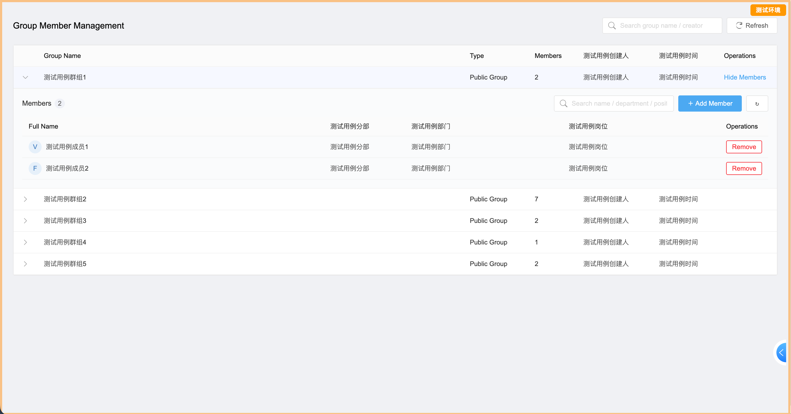
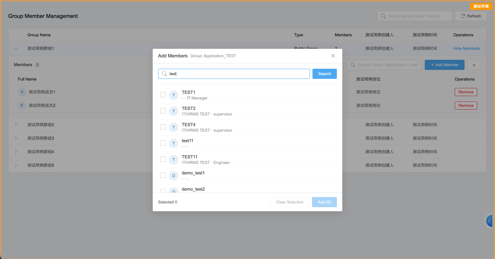

# e10-ecode-group-member-manager

基于**泛微 e-cology 10（E10）e-code 二次开发**的应用：让业务/模块管理员在**不进入管理后台**的情况下，用轻量、自助的页面管理自己的**公共群组成员**。

页面采用**参数驱动**：不同入口按钮传入不同的 `groupIds`，同一套代码即可为每个模块、部门或业务团队提供专属的"成员管理"页面。

> **说明**：页面界面为**纯英文**；如有需要，可自行借助 AI 工具将界面文案改为中文。

| | |
|---|---|
| 平台 | 泛微 e-cology 10 · e-code 二次开发 |
| UI | React（原生 JS）· 界面全英文 |
| 样式 | 对齐 E10 原生群组管理页 |
| 鉴权 | 同源调用，浏览器会话 Cookie |

---

## 为什么做这个项目

E10 自带了"群组管理"页面，为什么还要再造一个？

### 官方后台页面存在的问题

1. **只能后台操作、无法自助**：官方功能在管理后台里，业务/模块管理员通常没有后台权限，每次调整成员都要提工单找 IT。
2. **操作繁琐**：即使有后台权限，也要"点群组 → 成员管理 → 重选人器"多步才能增删成员，高频调整效率很低。
3. **权限不可控**：后台账号权限粗放，给业务人员开后台上限太大（组织、人员、流程、安全都能碰到），合规与安全风险高；平台没有"只允许改群组成员"这种细粒度权限。
4. **无法按模块隔离**：官方页面展示全部群组，私人组/公共组、群主、可见范围、自动配置混在一起，模块管理员看到大量无关信息，无法只看自己负责的群组。
5. **无法嵌入业务页面**：后台功能不能嵌入门户或业务页面，管理员要离开工作场景去后台操作。
6. **选人交互重**：官方选人器步骤多，缺少"输入即搜、点选即加"的快捷体验。
7. **界面固定不可定制**：样式、字段、隐藏项都不能按实际业务流程调整。
8. **低风险、可升级**：本方案用 e-code 标准二开能力 + 官方 HTTP 接口实现，不改平台核心、不打补丁，升级无忧。

---

## 功能特性

- **参数驱动群组**：入口传 `groupIds`（逗号分隔），页面只展示这些**公共**群组，按传入顺序排列。
- **展开即管理**：点击行直接展开成员列表，不用离开列表即可添加/移出成员。
- **人员快捷搜索**：输入姓名 / 拼音 / 账号 / 邮箱 / 手机号 → 防抖快捷搜索 → 勾选 → 添加。
- **移出二次确认**：一键移出 + 确认弹窗，成员数实时更新。
- **搜索与过滤**：按群组名/创建人过滤群组，按姓名/部门/岗位过滤成员。
- **E10 原生风格**：页面底色、表头、行高、主色、边框均对齐官方群组管理页。
- **空态与兜底**：不传参 → 明确的"未接收到参数"提示；传入不存在的群组 ID → 明确列出缺失项。

---

## 界面预览

> 以下截图来自测试环境，数据已脱敏（测试用例占位文字）。

**首页：群组列表 + 展开成员管理**



**添加成员：人员快捷搜索弹窗**



---

## 工作原理

```
e-builder 按钮（隐式传参 groupIds）
        │  sessionStorage.jumplinkParams
        ▼
/sp/custom/group-member-manager/members   ← e-code 页面（本应用）
        │  同源 fetch（浏览器会话 Cookie）
        ▼
E10 HTTP 接口（公共群组 / 成员 / 添加 / 移出 / 人员搜索）
```

- **鉴权**：同源调用，浏览器自动携带登录会话 Cookie。无 Token、无白名单、无额外配置。
- **UI**：原生 React 类组件 + 手写 CSS（不依赖重型 UI 库），编译为标准的 e-code 导入包。

---

## 部署

1. **构建**：使用 e-code 前端工具链（`ecodecmd-e10 compile && ecodecmd-e10 build`）生成导入包，导入到 E10 的 e-code 项目（新增或覆盖）。`build.json` 中的 id 故意留空——首次构建时自动生成。
2. **发布**：发布应用，使路由 `/sp/custom/group-member-manager/members` 生效。
3. **配置入口**：在 e-builder 中添加按钮，「打开页面」目标设为 `/sp/custom/group-member-manager/members`，选择**隐式传参**：
   - `groupIds` = 要管理的公共群组 ID（逗号分隔，例如 `1001,1002`）。
4. **完成**：每个传不同 `groupIds` 的按钮/页面，就是各自专属的成员管理入口，零额外代码。

## 参数说明

| 参数 | 是否必填 | 说明 |
|------|----------|------|
| `groupIds` | **必填** | 逗号分隔的公共群组 ID。为空时页面显示"未接收到参数"提示。 |

推荐使用 e-builder「隐式传参」；同时兼容 URL 直传兜底 `?groupIds=...`。

## 依赖的平台接口

均为同源 `POST`，鉴权走浏览器会话 Cookie。

| 用途 | 接口 |
|------|------|
| 公共群组列表 | `/api/bs/hrm/channel/list` |
| 群组成员列表 | `/api/bs/hrm/group/queryUser` |
| 添加成员 | `/api/bs/hrm/group/addUserLink` |
| 移出成员 | `/api/bs/hrm/group/deleteUserLink` |
| 人员快捷搜索 | `/api/hrm/common/browser/data/resource` |

---

## 项目结构

```
.
├── entry.js                    # 路由注册：/sp/custom/group-member-manager/members
├── index.js                    # 页面组件默认导出
├── build.json                  # e-code 应用配置（id 首次构建自动生成）
├── coms/
│   └── GroupMemberManager.js   # 页面组件：列表 / 展开 / 添加 / 移出 / 弹窗 / toast
├── styles/
│   └── group-member-manager.css
├── utils/
│   ├── api.js                  # 上述五个平台接口的封装
│   └── implicitParams.js       # 读取 e-builder 隐式传参
├── config/                     # e-code 生成的空配置占位
└── docs/                       # 界面截图
```

## License

[MIT](./LICENSE)
